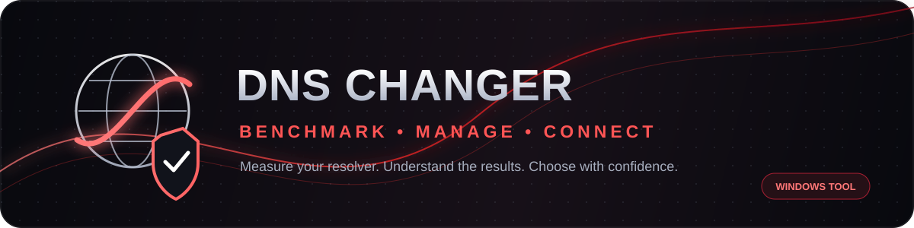

  
   
  <a href="#فارسی">🇮🇷 فارسی</a> · <a href="#english">🇬🇧 English</a>
    
  
  
  
  

---

## 🇮🇷 فارسی

# 🔴 DNS Changer & Benchmark

**DNSها را فقط عوض نکن؛ اول بسنج، مقایسه کن و بعد انتخاب کن.**

یک ابزار ویندوزی برای مدیریت DNS، بررسی کیفیت پاسخ‌گویی سرورها و اعمال سریع و کنترل‌شده تنظیمات شبکه؛ با تمرکز روی سادگی، تست قابل‌فهم و کنترل کامل کاربر.

  
   
  

### ⚡ امکانات اصلی

- 🧪 **DNS Benchmark:** نمایش Last Ping، Average، Jitter و نرخ درخواست‌های ناموفق (Packet Loss).
- 🚀 **تست تکی و گروهی:** بررسی یک DNS یا تمام اعضای یک گروه، با امکان توقف و مشاهده پیشرفت.
- 📂 **مدیریت DNSها:** ساخت گروه‌های دلخواه، Favorite، Pin و ذخیره دائمی اطلاعات.
- 🔌 **DNS Changer:** اتصال و قطع اتصال DNS با امکان بازگردانی تنظیمات قبلی ویندوز.
- 🧹 **Flush DNS:** پاک‌سازی کش DNS ویندوز با یک فرمان.
- 🌐 **محافظت هنگام قطعی اینترنت:** بررسی اتصال پیش از تست یا تغییر DNS و توقف عملیات گروهی در صورت قطع ارتباط.
- 🎨 **تجربه کاربری:** تم تیره و روشن، فارسی و انگلیسی، و Minimize to Tray.

### 📊 معیارهای تست

| معیار | چه چیزی را نشان می‌دهد؟ |
|---|---|
| **Last Ping** | زمان آخرین پاسخ موفق DNS |
| **Average** | میانگین زمان پاسخ درخواست‌های موفق |
| **Jitter** | میانگین اختلاف زمان پاسخ‌های موفق متوالی |
| **Packet Loss** | درصد درخواست‌های تست که پاسخ معتبر نگرفته‌اند |

> ⚠️ «Ping» این برنامه زمان پاسخ DNS است، نه Ping سرور بازی. Packet Loss هم نرخ شکست درخواست‌های DNS در تست است؛ نه اندازه‌گیری افت بسته در کل مسیر بازی.

### 🆚 مقایسه با Nexus Tweaks

**این دو ابزار دقیقاً یک نوع محصول نیستند:** DNS Changer یک ابزار تخصصی DNS است؛ Nexus Tweaks یک مجموعه بهینه‌سازی ویندوز و گیمینگ است که DNS Changer را هم در نسخه Pro ارائه می‌کند.

| قابلیت | DNS Changer | Nexus Tweaks |
|---|:---:|:---:|
| تغییر DNS ویندوز | ✅ | ✅ Pro |
| تست و مقایسه DNS | ✅ | ✅ ابزارهای Network / DNS |
| Last / Average / Jitter / نرخ خطای DNS | ✅ | بخشی از ابزارهای شبکه؛ روش نمایش متفاوت |
| گروه‌های اختصاصی، Favorite و Pin برای DNS | ✅ | در مستندات عمومی محصول ذکر نشده |
| تست تکی و گروهی DNS | ✅ | جزئیات این گردش‌کار به‌صورت عمومی مشخص نشده |
| پاک‌سازی DNS Cache ویندوز | ✅ | در فهرست رسمی قابلیت‌ها ذکر نشده |
| Bufferbloat و Traceroute | — | ✅ Pro |
| ابزارهای گسترده بهینه‌سازی ویندوز و Game Booster | — | ✅ |

**جمع‌بندی:** اگر مدیریت و مقایسه DNSها کار اصلی توست، DNS Changer روی همین کار متمرکز است. اگر علاوه بر DNS به Game Booster، Bufferbloat و صدها تنظیم ویندوز نیاز داری، Nexus ابزار گسترده‌تری است. جزئیات Nexus بر اساس [صفحه امکانات](https://nexustweaks.com/) و [مقایسه پلن‌ها](https://nexustweaks.com/pricing) است.

### 🎮 آیا پینگ بازی را پایین می‌آورد؟

ممکن است DNS سریع‌تر، زمان پیدا کردن آدرس سرویس‌ها را کمتر کند؛ اما **کاهش Ping داخل بازی تضمین نمی‌شود**. بعد از برقراری ارتباط با IP سرور بازی، DNS معمولاً در مسیر بسته‌های بازی نقشی ندارد. برای بررسی Ping واقعی DayZ باید IP سرور و مسیر شبکه جداگانه آزمایش شوند.

### 🛠️ فناوری‌ها

`Python` · `PySide6` · `SQLite` · `QThread` · `PyInstaller`

**وضعیت:** قابلیت‌های معرفی‌شده در این README در نسخه فعلی برنامه پیاده‌سازی شده‌اند.

---

## 🇬🇧 English

# 🔴 DNS Changer & Benchmark

**Don’t just switch DNS. Test it, compare it, then choose.**

A Windows utility for managing DNS resolvers, measuring their response quality, and applying network settings with a clear, user-controlled workflow.

  
   
  

### ⚡ Core features

- 🧪 **DNS Benchmark:** Last Ping, Average, Jitter, and DNS query failure rate (Packet Loss).
- 🚀 **Single & group testing:** Test one resolver or an entire custom group; track progress and stop a run.
- 📂 **DNS library:** Custom groups, Favorites, pinned resolvers, and persistent local storage.
- 🔌 **DNS Changer:** Apply or disconnect DNS settings and restore the previous Windows configuration.
- 🧹 **Flush DNS:** Clear the Windows DNS cache in one action.
- 🌐 **Offline protection:** Check connectivity before testing or applying DNS; stop group tests if the connection drops.
- 🎨 **User experience:** Dark and Light themes, Persian and English UI, and Minimize to Tray.

### 📊 Benchmark metrics

| Metric | What it tells you |
|---|---|
| **Last Ping** | Latest successful DNS response time |
| **Average** | Mean time of successful DNS responses |
| **Jitter** | Mean absolute difference between consecutive successful response times |
| **Packet Loss** | Percentage of test queries that did not receive a valid response |

> ⚠️ The displayed “Ping” is DNS response time, not game-server ping. “Packet Loss” is the DNS test failure rate, not packet loss across the full route to a game server.

### 🆚 DNS Changer vs. Nexus Tweaks

**They serve different purposes.** DNS Changer is focused on DNS management and resolver benchmarking. Nexus Tweaks is a broader Windows and gaming optimization suite, with a DNS changer included in its Pro plan.

| Feature | DNS Changer | Nexus Tweaks |
|---|:---:|:---:|
| Change Windows DNS | ✅ | ✅ Pro |
| DNS testing and comparison | ✅ | ✅ Network / DNS tools |
| Last / Average / Jitter / DNS query failure rate | ✅ | Network metrics are available; presentation differs |
| Custom DNS groups, Favorites & Pins | ✅ | Not listed in public product docs |
| Single and group DNS test workflow | ✅ | Workflow details not publicly specified |
| Windows DNS cache flush | ✅ | Not listed in official feature pages |
| Bufferbloat and Traceroute | — | ✅ Pro |
| Broad Windows tweaks and Game Booster | — | ✅ |

**In short:** Choose DNS Changer for a focused DNS workflow. Choose Nexus if you also need Game Booster, Bufferbloat testing, and a much broader set of Windows tweaks. See the [Nexus feature overview](https://nexustweaks.com/) and [official plan comparison](https://nexustweaks.com/pricing).

### 🎮 Will it lower in-game ping?

A faster resolver may reduce the time needed to look up a service address, but **lower in-game ping is not guaranteed**. Once a game communicates with a server IP, DNS is generally not part of the ongoing packet route. To measure actual DayZ latency, test the game server IP and network path separately.

### 🛠️ Built with

`Python` · `PySide6` · `SQLite` · `QThread` · `PyInstaller`

**Status:** The features described in this README are implemented in the current application build.

---

  🔴 Measure. Compare. Connect. Stay in control.

