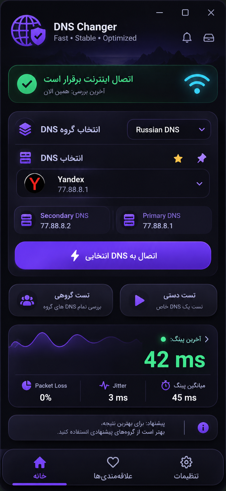

  
   
  <a href="#فارسی"><strong>فارسی</strong></a> · <a href="#english"><strong>English</strong></a>
    
  
  
  
  

---

# فارسی

## معرفی پروژه

**DNS Changer & Benchmark** یک ابزار دسکتاپ برای ویندوز است که با هدف مدیریت DNSها، سنجش عملکرد Resolverها از روی اتصال واقعی کاربر و اعمال کنترل‌شده تنظیمات DNS طراحی شده است.

ایده اصلی پروژه فقط «عوض‌کردن DNS» نیست؛ کاربر باید بتواند DNSهای دلخواهش را در گروه‌های شخصی نگه دارد، آن‌ها را جداگانه یا گروهی آزمایش کند، کیفیت پاسخ‌دهی را با چند معیار ببیند و در صورت انتخاب، DNS موردنظر را با امکان بازگردانی تنظیمات قبلی روی ویندوز اعمال کند.

> **وضعیت پروژه: در حال توسعه / مشخصات هدف** — این README قابلیت‌های طراحی‌شده برای نسخه هدف را توضیح می‌دهد. تا زمانی که هر قابلیت در نسخه اجرایی پیاده‌سازی و آزمایش نشده باشد، نباید آن را قابلیت منتشرشده یا تضمین‌شده تلقی کرد.

## پیش‌نمایش طراحی

  
   
  طرح مفهومی آیکون برنامه — فایل نهایی آیکون پس از آماده‌سازی نسخه اجرایی یکپارچه می‌شود.

  
   
  تصویر مرجع طراحی صفحه خانه؛ رابط نهایی باید به‌صورت اجزای واقعی و تعاملی PySide6 پیاده‌سازی شود، نه به‌عنوان تصویر پس‌زمینه.

## چه کاری انجام می‌دهد؟

### ۱. آزمایش DNS از اتصال خود کاربر

برنامه برای هر DNS مستقیماً به IP سرور موردنظر درخواست DNS می‌فرستد و زمان رفت‌وبرگشت پاسخ معتبر را اندازه می‌گیرد. تست پایه بر UDP پورت 53 انجام می‌شود و به DNS پیش‌فرض ویندوز وابسته نیست.

معیارهای اصلی:

| معیار | مفهوم |
|---|---|
| **Last Ping** | زمان آخرین پاسخ موفق DNS |
| **Average Ping** | میانگین زمان پاسخ درخواست‌های موفق |
| **Jitter** | میانگین اختلاف مطلق زمان پاسخ‌های موفق متوالی |
| **Packet Loss** | درصد درخواست‌های آزمایشی که پاسخ معتبر دریافت نکرده‌اند |

**توضیح مهم درباره Packet Loss:** در این برنامه، این شاخص نرخ درخواست‌های DNS بی‌پاسخ یا ناموفق در آزمایش است؛ معادل اندازه‌گیری Packet Loss در تمام مسیر شبکه یا ترافیک بازی نیست. همچنین «Ping» نمایش‌داده‌شده زمان پاسخ DNS است، نه ICMP Ping.

### ۲. تست تکی و گروهی

- اجرای تست روی یک DNS انتخاب‌شده.
- آزمایش تمام DNSهای یک گروه به‌صورت ترتیبی.
- نمایش DNS در حال آزمایش، درصد پیشرفت، تعداد موارد انجام‌شده و باقی‌مانده.
- امکان توقف عملیات.
- مرتب‌سازی نتیجه‌ها بر اساس Average، Jitter، Packet Loss یا Last Ping.
- مقدار پیش‌فرض ۲۰ نمونه برای هر DNS و امکان تغییر آن از تنظیمات.

### ۳. مدیریت گروه‌ها و علاقه‌مندی‌ها

- ساخت گروه با نام دلخواه؛ برای مثال `Gaming DNS`، `Russian DNS`، `Low Latency` یا `Personal`.
- افزودن، ویرایش، حذف و جابه‌جایی DNSها.
- نام اختصاصی برای هر DNS و ثبت Primary و Secondary.
- Favorite و Pin برای دسترسی سریع.
- نگهداری اطلاعات در SQLite تا پس از بستن برنامه باقی بمانند.

### ۴. اتصال و بازگردانی DNS ویندوز

انتخاب DNS به‌تنهایی نباید تنظیمات سیستم را تغییر دهد. اعمال DNS فقط با فرمان صریح کاربر انجام می‌شود. برنامه باید کارت شبکه فعال را تشخیص دهد، پیش از تغییر اتصال را بررسی کند، تنظیمات قبلی را ذخیره کند و هنگام Disconnect امکان بازیابی آن‌ها را فراهم سازد.

اگر مجوز Administrator لازم باشد، برنامه باید آن را به شکل روشن درخواست کند. در صورت شکست عملیات تغییر DNS نیز باید تلاش برای بازگردانی وضعیت قبلی انجام شود.

### ۵. تشخیص اتصال اینترنت

پیش از شروع Benchmark یا اعمال DNS، دسترسی اینترنت بررسی می‌شود. این بررسی نباید فقط به DNS متکی باشد. در طراحی فعلی، اتصال به چند مقصد مستقل در نظر گرفته شده است؛ در صورت نامشخص‌بودن وضعیت اتصال، برنامه نباید DNS جدیدی اعمال کند. اگر ارتباط حین تست گروهی قطع شود، عملیات باید متوقف شود.

### ۶. رابط کاربری و تجربه استفاده

- رابط فارسی و انگلیسی با چیدمان RTL/LTR متناسب با زبان.
- سه بخش اصلی Home، Favorites و Settings.
- تم تیره گرافیتی با تأکید قرمز و تم روشن با پس‌زمینه سفید.
- طراحی کارت‌محور، خلوت، خوانا و الهام‌گرفته از تجربه موبایل مدرن.
- کمینه‌سازی به System Tray در صورت فعال‌بودن گزینه مربوطه.
- نمایش نتایج با رنگ‌بندی قابل فهم، بدون شلوغ‌کردن صفحه.

## چرا این ابزار می‌تواند مفیدتر باشد؟

ارزش پروژه در **یکپارچه‌کردن انتخاب، آزمایش، سازمان‌دهی و اعمال DNS** در یک جریان کاری ساده است. برای کاربری که DNSهای زیادی را از منابع مختلف جمع‌آوری می‌کند، امکان ساخت گروه‌های اختصاصی و مقایسه آن‌ها با معیارهای یکسان می‌تواند از تعویض دستی و آزمون پراکنده راحت‌تر و قابل‌تکرارتر باشد.

### مقایسه واقع‌بینانه با ابزارهای مشابه

| قابلیت | DNS Changer & Benchmark (هدف پروژه) | DNS Jumper | GRC DNS Benchmark |
|---|---|---|---|
| تغییر DNS ویندوز | در مشخصات پروژه | دارد | امکان تغییر مستقیم، محور اصلی ابزار نیست |
| افزودن DNS سفارشی و گروه‌ها | برنامه‌ریزی شده | دارد | فهرست‌های سفارشی دارد |
| تست تکی و گروهی | برنامه‌ریزی شده | تست خودکار فهرست دارد | Benchmark چند Resolver را مقایسه می‌کند |
| نمایش Last / Average / Jitter / نرخ Timeout | هدف اصلی رابط | زمان پاسخ و قابلیت اطمینان پایه | تحلیل زمان پاسخ و Reliability؛ معیارهای تخصصی بیشتر |
| پشتیبانی از Favorite و Pin | برنامه‌ریزی شده | در مشخصات بررسی‌شده، ویژگی محوری نیست | مدل اصلی ابزار بر این ساختار تکیه ندارد |
| ذخیره گروه‌های شخصی | برنامه‌ریزی شده | دارد | فهرست‌های سفارشی/INI دارد |
| تشخیص اینترنت پیش از تست | برنامه‌ریزی شده | در صفحه ویژگی‌های بررسی‌شده، محور اصلی نیست | بررسی اتصال و مدیریت قطع اتصال را مستند کرده است |
| تحلیل Cache / Uncached و DNSSEC | در مشخصات فعلی تعریف نشده | محور اصلی نیست | دارد |
| رابط فارسی و انگلیسی | هدف پروژه | زبان‌های متعدد دارد | رابط و گزارش‌های اصلی آن انگلیسی‌محور است |

**برداشت منصفانه از مقایسه:** این پروژه قرار نیست در روز اول جایگزین کامل GRC DNS Benchmark در تحلیل تخصصی و آماری شود. GRC امکاناتی مانند مقایسه Cached و Uncached، بررسی DNSSEC و تحلیل آماری گسترده دارد. DNS Jumper نیز از قبل تغییر سریع DNS، تست زمان پاسخ، گروه‌ها و پشتیبان‌گیری/بازیابی تنظیمات را ارائه می‌کند. تمایز موردنظر این پروژه، تجربه یکپارچه و ساده‌تر برای مدیریت فهرست‌های شخصی، دیدن هم‌زمان چند شاخص در هر DNS، تست تکی/گروهی و روند ایمن‌تر اعمال و بازگردانی DNS است.

## آیا می‌تواند پینگ بازی را کاهش دهد؟

**گاهی ممکن است زمان Resolve شدن نام دامنه یا اتصال اولیه به یک سرویس بهتر شود؛ اما کاهش پینگ داخل بازی تضمین‌شدنی نیست.** پس از برقراری ارتباط با IP سرور بازی، DNS معمولاً در مسیر بسته‌های بازی دخالت ندارد. بنابراین این برنامه می‌تواند Resolver سریع‌تر و پایدارتر را در شبکه فعلی کاربر شناسایی کند، اما به‌تنهایی مسیر Routing اپراتور، ازدحام شبکه، کیفیت خط ADSL، Wi-Fi، Bufferbloat یا Packet Loss مسیر تا سرور بازی را اصلاح نمی‌کند.

برای بازی‌هایی مانند DayZ، نتیجه DNS Benchmark را باید شاخص کیفیت پاسخ‌گویی Resolver دانست، نه پیش‌بینی قطعی Ping سرور بازی. برای تحلیل پینگ واقعی بازی باید IP سرور مقصد و مسیر شبکه جداگانه بررسی شود.

## کیفیت و معیارهای مهندسی

کیفیت نهایی این ابزار به کیفیت اجرای واقعی آن وابسته است، نه صرفاً تعداد قابلیت‌های فهرست‌شده. معیارهای هدف عبارت‌اند از:

- **اندازه‌گیری قابل تکرار:** استفاده از درخواست DNS معتبر، زمان‌سنجی یکنواخت و تعداد نمونه مشخص.
- **گزارش شفاف:** نمایش تعداد نمونه موفق/ناموفق، Timeout و وضعیت ناقص‌بودن تست.
- **محافظت از تنظیمات سیستم:** ذخیره DNS قبلی و بازیابی قابل اتکا هنگام قطع اتصال یا خطا.
- **عدم فریز رابط:** اجرای عملیات شبکه و سیستم در Worker/QThread.
- **پایداری داده:** نگهداری DNSها، گروه‌ها، تنظیمات و نتایج در SQLite.
- **قابل فهم بودن:** متن روشن برای خطاها، وضعیت اینترنت و نتیجه Benchmark.
- **آزمایش قبل از انتشار:** تست روی Windows 10 و Windows 11، کارت شبکه‌های مختلف و حالت‌های Online/Offline.

در مشخصات Benchmark، پس از سه شکست متوالی برای یک DNS، آزمایش همان DNS متوقف می‌شود؛ این رفتار کمک می‌کند یک Resolver غیرقابل دسترس زمان تست گروهی را بی‌جهت طولانی نکند.

## فناوری‌ها

| فناوری | کاربرد |
|---|---|
| Python | زبان اصلی |
| PySide6 | رابط گرافیکی دسکتاپ |
| SQLite | ذخیره‌سازی محلی |
| QThread / Worker | اجرای عملیات بدون فریز رابط |
| PyInstaller | بسته‌بندی نسخه ویندوز |

## وضعیت توسعه

| بخش | وضعیت |
|---|---|
| طراحی رابط و تجربه کاربری | مشخصات و طرح مرجع آماده |
| DNS Benchmark | در انتظار پیاده‌سازی و تست |
| مدیریت گروه‌ها و علاقه‌مندی‌ها | در انتظار پیاده‌سازی و تست |
| اعمال و بازیابی DNS ویندوز | در انتظار پیاده‌سازی و تست |
| زبان فارسی و انگلیسی | در انتظار پیاده‌سازی و تست |
| ساخت EXE و انتشار | در انتظار پیاده‌سازی و تست |

## حریم خصوصی و امنیت

هدف طراحی این است که اطلاعات گروه‌ها و تنظیمات به‌صورت محلی در SQLite ذخیره شوند. برای Benchmark، درخواست‌های DNS به Resolverهای انتخاب‌شده ارسال می‌شوند؛ بنابراین ارائه‌دهنده Resolver می‌تواند درخواست‌های دریافتی را مشاهده کند. انتخاب DNS باید با توجه به سیاست حریم خصوصی و اعتماد به ارائه‌دهنده انجام شود.

تا زمان انتشار کد و نسخه قابل بررسی، هیچ ادعای ممیزی امنیتی، تأیید مستقل یا تضمین ناشناس‌ماندن مطرح نمی‌شود.

## نصب و اجرا

روش نصب نهایی پس از آماده‌شدن مخزن و نسخه قابل انتشار تکمیل می‌شود. هدف انتشار شامل سورس Python، فایل وابستگی‌ها، دیتابیس خودکار، اسکریپت Build و نسخه EXE ویندوز است.

## مشارکت و گزارش مشکل

پس از عمومی‌شدن مخزن، گزارش خطاها، پیشنهاد قابلیت‌ها و مشارکت در کد از طریق GitHub Issues و Pull Requests قابل پیگیری خواهد بود. هنگام گزارش مشکل، نسخه ویندوز، نوع اتصال اینترنت، نام کارت شبکه و لاگ مرتبط را بدون اطلاعات حساس ارسال کنید.

## سلب مسئولیت

این ابزار برای سنجش Resolverهای DNS و مدیریت تنظیمات DNS ویندوز طراحی شده است. نتیجه Benchmark به موقعیت جغرافیایی، ISP، زمان آزمایش، مسیر شبکه، محدودیت‌های UDP/53 و وضعیت خود Resolver وابسته است. هیچ DNSی برای همه کاربران و همه زمان‌ها بهترین نیست.

---

# English

## Project Overview

**DNS Changer & Benchmark** is a planned Windows desktop utility for organizing DNS resolvers, measuring their response behavior from the user's own connection, and applying selected DNS settings with a controlled restore path.

The goal is not merely to switch DNS addresses. Users should be able to maintain named resolver groups, benchmark one resolver or an entire group, compare clear metrics, and explicitly apply a selected configuration to Windows while preserving the previous settings for restoration.

> **Project status: In development / target specification.** This README describes the intended product. A feature must be implemented and tested in a released build before it can be considered available or guaranteed.

## Design Preview

  
   
  Concept app icon. The final icon will be integrated into the executable and Windows notification area.

  
   
  Home-screen visual reference. The shipped interface is intended to use real, interactive PySide6 widgets rather than a background screenshot.

## What It Is Designed to Do

### 1. Benchmark DNS resolvers from the user's connection

The benchmark sends DNS queries directly to the selected resolver IP over UDP port 53. Timing starts when a query is sent and ends when a valid DNS response is received. It does not rely on the DNS server currently configured in Windows to reach the tested resolver.

| Metric | Meaning |
|---|---|
| **Last Ping** | Response time of the latest successful DNS query |
| **Average Ping** | Mean response time across successful queries |
| **Jitter** | Mean absolute difference between consecutive successful response times |
| **Packet Loss** | Percentage of test queries that did not produce a valid response |

**Metric clarification:** Packet Loss in this application means the failure/timeout rate of its DNS test queries. It is not a measurement of packet loss across all network traffic or the game route. The displayed “Ping” is DNS query response time, not ICMP echo latency.

### 2. Single and group testing

- Test one selected resolver.
- Test every resolver in a selected group sequentially.
- Show the active resolver, progress percentage, completed count, and remaining count.
- Allow the user to stop a running test.
- Sort results by Average, Jitter, Packet Loss, or Last Ping.
- Use 20 samples per resolver by default, with a user-configurable sample count.

### 3. Resolver groups and favorites

- Create custom groups such as `Gaming DNS`, `Russian DNS`, `Low Latency`, or `Personal`.
- Add, edit, remove, and move resolvers between groups.
- Assign a display name and configure Primary and Secondary addresses.
- Pin important resolvers and mark favorites.
- Persist groups and resolver data locally in SQLite.

### 4. Apply and restore Windows DNS settings

Selecting a resolver must not change Windows settings by itself. Applying DNS must require an explicit user action. The application is designed to detect the active network adapter, check connectivity before applying changes, preserve the previous DNS configuration, and restore it when the user disconnects.

Administrator permission must be requested clearly when required. If applying a new configuration fails, the application should attempt to restore the previous configuration.

### 5. Internet connectivity awareness

Connectivity should be checked before benchmarking or applying DNS. The check must not depend only on DNS resolution. The target design uses multiple independent connectivity destinations; if connectivity is unavailable or uncertain, the application must not apply a new DNS configuration. A group benchmark should stop if internet connectivity is lost during the run.

### 6. User interface

- Persian and English interfaces with appropriate RTL/LTR layout.
- Three main sections: Home, Favorites, and Settings.
- Dark graphite theme with red accents, plus a bright white theme.
- Clean cards, readable metrics, and a low-clutter layout.
- Optional minimize-to-system-tray behavior.
- Clear status colors and understandable error messages.

## Where It Can Add More Value

The intended advantage is the **combination of resolver organization, consistent testing, at-a-glance metrics, and controlled Windows DNS management** in one approachable workflow. Users who collect many DNS addresses can create their own groups, run repeatable single or group tests, compare the same metrics, and apply or restore a configuration without repeatedly navigating Windows network settings.

### A Realistic Comparison

| Capability | DNS Changer & Benchmark (planned) | DNS Jumper | GRC DNS Benchmark |
|---|---|---|---|
| Change Windows DNS | Planned | Yes | Not its primary focus |
| Custom resolvers and groups | Planned | Yes | Supports custom resolver lists |
| Single and group tests | Planned | Automated list testing | Multi-resolver benchmarking |
| Last / Average / Jitter / query-failure rate | Planned core display | Response-time and reliability checks | Response-time and reliability analysis, plus advanced metrics |
| Favorites and pinned resolvers | Planned | Not a central documented workflow | Not its core organization model |
| Connectivity-aware benchmarking | Planned | Not a central feature in the reviewed feature list | Documents connectivity checks and handling interrupted connectivity |
| Cached / uncached and DNSSEC analysis | Not in current specification | Not its main focus | Yes |
| Persian and English UI | Planned | Supports multiple languages | Primarily English-oriented interface and reports |

**Fair positioning:** This project should not claim to replace GRC DNS Benchmark's deeper statistical analysis. GRC documents cached/uncached testing, DNSSEC-related checks, and extensive resolver analysis. DNS Jumper already offers quick DNS changes, response-time checks, custom servers, groups, and backup/restore. The intended distinction here is a unified, approachable workflow for personal resolver collections, visible per-resolver metrics, single/group testing, and a careful apply/restore flow.

## Can It Reduce In-Game Ping?

**It may improve DNS lookup time or the initial resolution step in some situations, but it cannot guarantee lower in-game ping.** Once a game has established communication with a server IP, DNS is generally not in the path of the ongoing game packets. This application can help identify a resolver that responds more quickly and consistently from the user's current network; it cannot, by itself, repair ISP routing, congestion, ADSL line quality, Wi-Fi interference, bufferbloat, or packet loss on the route to a game server.

For games such as DayZ, DNS benchmark results should be interpreted as resolver-response measurements, not as a prediction of the game's server ping. Actual game latency requires a separate test against the game server IP and its network route.

## Quality Goals

The quality of the final product depends on implementation and validation, not on the feature list alone. Engineering goals include:

- **Repeatable measurements:** valid DNS queries, consistent timing, and a defined sample count.
- **Transparent reporting:** successful and failed sample counts, timeouts, and incomplete-test states.
- **System safety:** preserve the previous DNS configuration and make restoration reliable.
- **Responsive UI:** run network and system operations in workers/QThreads.
- **Persistent data:** keep resolvers, groups, settings, and test results in SQLite.
- **Clear feedback:** understandable connectivity, progress, and error states.
- **Release validation:** test on Windows 10 and Windows 11, across network adapters and online/offline scenarios.

The current benchmark specification stops testing a resolver after three consecutive failures (timeouts or responses over 999 ms), then moves to the next resolver in a group. This is intended to prevent one unavailable resolver from unnecessarily delaying the entire run.

## Technology Stack

| Technology | Purpose |
|---|---|
| Python | Core application |
| PySide6 | Desktop interface |
| SQLite | Local persistence |
| QThread / Worker | Non-blocking operations |
| PyInstaller | Windows executable packaging |

## Development Status

| Area | Status |
|---|---|
| UI design and reference | Specification and visual reference prepared |
| DNS Benchmark engine | Pending implementation and testing |
| Groups and favorites | Pending implementation and testing |
| Windows DNS apply/restore | Pending implementation and testing |
| Persian and English localization | Pending implementation and testing |
| EXE packaging and release | Pending implementation and testing |

## Privacy and Security

The design goal is to keep groups and application preferences locally in SQLite. Benchmark queries are sent to the DNS resolvers selected by the user; resolver operators may therefore observe the queries they receive. Select providers based on their published privacy practices and your trust in them.

No independent security audit, anonymity guarantee, or security certification is claimed before the source code and a release build are available for review.

## Build and Installation

Final installation instructions will be published when the repository contains a tested release. The planned deliverables include Python source code, dependency declarations, automatic SQLite initialization, a build script, and a Windows executable.

## Contributing and Bug Reports

Once the repository is public, feature requests, bug reports, and code contributions can be handled through GitHub Issues and Pull Requests. When reporting an issue, include the Windows version, connection type, network adapter, and relevant logs—but remove private or sensitive information.

## Disclaimer

This application is designed to benchmark DNS resolvers and manage Windows DNS settings. Results vary with geographic location, ISP, time of day, network route, UDP/53 filtering, and resolver health. No DNS provider is universally fastest for every user or every network.

---

## References / Further Reading

- [DNS Jumper — Sordum: features, custom DNS, groups, response-time checks, and backup/restore](https://www.sordum.org/7952/dns-jumper-v2-3/)
- [GRC DNS Benchmark — feature overview and resolver testing methodology](https://www.grc.com/dns/features.htm)
- [GRC DNS Benchmark — FAQ and DNS query / UDP port 53 notes](https://www.grc.com/dns/benchmark-faq.htm)

  Built around one principle: measure first, choose deliberately, and keep control of your network settings.

